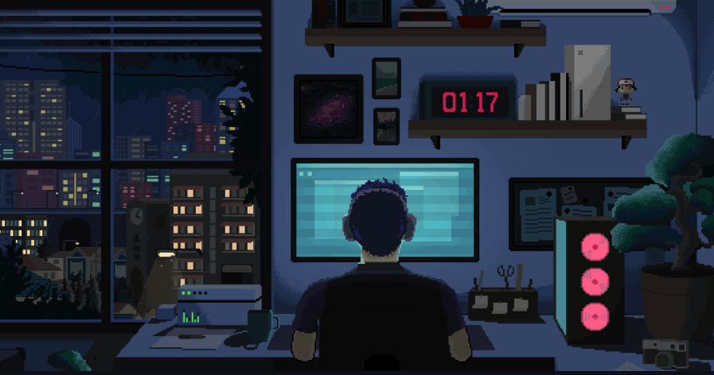

<!-- ======================= 3D ANIMATED HEADER ======================= -->
<div align="center">
  
</div>

<div align="center">

[](https://github.com/Ayush-1812)

<br/>

<a href="https://www.linkedin.com/in/ayush-carpenter-b1785237b/"></a>&nbsp;
<a href="https://ayush-portfolio-three-gamma.vercel.app/"></a>&nbsp;
<a href="mailto:ayushcarpenter1812.work@gmail.com"></a>&nbsp;
<a href="https://leetcode.com/u/Ayush__2004/"></a>&nbsp;
<a href="https://www.codechef.com/users/aayush_1812"></a>

<br/><br/>


<a href="https://github.com/Ayush-1812?tab=followers"></a>

</div>


<!-- ======================= ABOUT ======================= -->
##  &nbsp;About Me

<table>
<tr>
<td width="54%" valign="top">

I'm a **final-year CSE undergrad at IIIT Kota** who got hooked on the part of software most people scroll past — the layer underneath. Threads racing each other. Sockets dropping mid-handshake. A query that was fine at 100 rows and a disaster at 100,000.

So that's what I build. A **work-stealing scheduler in C++20** that survives 100,000-task stress runs. A **telemedicine platform** where two strangers get a clean P2P video call through a signalling server I wrote. A **Go game engine** that processes every command exactly once, even when a player's wifi dies mid-turn.

Between builds I'm on LeetCode — **1,050+ problems** deep, currently **Knight at 1924**. Same instinct, smaller canvas.

**Currently:** distributed systems, lock-free concurrency, and agentic AI pipelines.

</td>
<td width="46%" valign="middle" align="center">



<sub><i>01:17 — the good hours</i></sub>

</td>
</tr>
</table>

<div align="center">

&nbsp;
&nbsp;
&nbsp;
&nbsp;
&nbsp;


</div>

<br/>

<details>
<summary><b>&nbsp;📜 &nbsp;The machine-readable version</b></summary>
<br/>

```ts
const ayush: Engineer = {
  education : "B.Tech CSE @ IIIT Kota  (2023 - 2027)  |  CGPA 7.78",
  role      : "Ex-Frontend Developer Intern @ Gyanama",
  focus     : ["Backend Engineering", "Distributed Systems", "AI / LLMs"],
  stack     : {
    languages : ["C++20", "Go", "TypeScript", "Python", "Java"],
    web       : ["Next.js 16", "React 19", "Node.js", "Tailwind"],
    realtime  : ["WebRTC", "Socket.IO", "WebSockets", "Redis Pub/Sub"],
    data      : ["PostgreSQL", "MongoDB", "Prisma", "Redis"],
    infra     : ["Docker", "Kubernetes", "AWS", "GitHub Actions"],
  },
  competitive : { leetcode: "Knight - 1924", codechef: "3 Star", codeforces: "Pupil - 1380" },
  solved      : "1,050+ DSA problems",
  reachMe     : "ayushcarpenter1812.work@gmail.com",
};
```

</details>


<!-- ======================= TECH STACK ======================= -->
##  &nbsp;Tech Arsenal

<div align="center">

### &nbsp;Languages


### &nbsp;Frontend


### &nbsp;Backend &amp; Real-Time


### &nbsp;Databases &amp; ORM


### &nbsp;DevOps &amp; Tools


<br/>


</div>


<!-- ======================= PROJECTS ======================= -->
##  &nbsp;Featured Projects

<table>
<tr>
<td width="50%" valign="top">

### MediCare
**Full-stack telemedicine platform**

Peer-to-peer video consultations over **WebRTC** with a custom **Node.js + Socket.IO** signalling server for SDP/ICE negotiation, and **Redis pub/sub** syncing sessions across instances. JWT auth with **RBAC across 3 roles**, 39 type-safe Server Actions, 6 Prisma models, Razorpay payments and a **7-tool Gemini health assistant**.

`Next.js 16` `React 19` `PostgreSQL` `Prisma` `WebRTC` `Socket.IO` `Redis` `Docker`

<a href="https://medi-care-2vbm.vercel.app/"></a>
<a href="https://github.com/Ayush-1812/MediCare"></a>

</td>
<td width="50%" valign="top">

### ThreadForge
**C++20 work-stealing task scheduler**

Worker-local queues with **work stealing** and weighted High/Normal/Low priority scheduling. Dependency-aware **fan-in/fan-out execution** without blocking workers, plus exception-safe futures, graceful shutdown and per-worker metrics. Validated by **150 CTest checks**, **100,000-task stress workloads**, GCC/Clang sanitizer CI and **54 Google Benchmark cases**.

`C++20` `CMake` `GoogleTest` `Google Benchmark` `GitHub Actions`

<a href="https://github.com/Ayush-1812/ThreadForge#readme"></a>
<a href="https://github.com/Ayush-1812/ThreadForge"></a>

</td>
</tr>

<tr>
<td width="50%" valign="top">

### CardPlay
**Real-time multiplayer card-game platform**

Monopoly Deal and Trump over **WebSockets**, with verified **exactly-once command processing** for 8 concurrent actions and loss-free recovery across restart/reconnect tests. Authoritative **Go rules engines** sit behind one pluggable game interface — **89.7% test coverage** and **46 end-to-end tests** across 4 live player sessions.

`Go` `PostgreSQL` `WebSockets` `Next.js` `TypeScript` `Docker`

<a href="https://card-play01.vercel.app/"></a>
<a href="https://github.com/Ayush-1812/CardPlay"></a>

</td>
<td width="50%" valign="top">

### WealthWise
**AI-powered personal finance platform**

Clerk auth, **Recharts** dashboards, **Gemini receipt OCR** and **Inngest**-driven automated budget alerts and reports. Ships a Splitwise-style expense module with **6 split algorithms**, group/friend management with RBAC, **pairwise debt netting** and settlements on a derived-balance ledger spanning **10 tables**.

`Next.js 15` `React 19` `PostgreSQL` `Prisma` `Tailwind` `Gemini API` `Inngest`

<a href="https://welth-wise-nwr1-git-main-ayush-carpenters-projects.vercel.app?_vercel_share=FEFuMl3IlS5TqgYe7nsj3llDAY9W4rlM"></a>
<a href="https://github.com/Ayush-1812/WelthWise"></a>

</td>
</tr>

<tr>
<td width="50%" valign="top">

### VersionVista
**Git repository visualizer**

Parses and indexes repo metadata with **simple-git** to replay commit history as an **interactive timeline**. Implements file-level and line-level **diff analysis** with side-by-side comparison, handling **1,000+ commit** repositories without blocking the UI. The dashboard pairs a commit tree, file explorer and code viewer with MongoDB caching that **cut analysis time by 60%**.

`Next.js` `React.js` `MongoDB` `simple-git`

<a href="https://inquisitive-narwhal-2c09de.netlify.app/"></a>
<a href="https://github.com/prayag0one4/VersionVista"></a>

</td>
<td width="50%" valign="top">

### More on the way
**Currently building**

Digging deeper into **distributed systems**, **lock-free concurrency** in C++ and Go, and **agentic AI** pipelines. New repositories land here as they ship.

<br/>

<a href="https://github.com/Ayush-1812?tab=repositories"></a>

</td>
</tr>
</table>


<!-- ======================= STATS ======================= -->
##  &nbsp;GitHub Analytics

<div align="center">


<br/><br/>


<br/><br/>


</div>


<!-- =================== 3D CONTRIBUTION SKYLINE (DISABLED) ===================

  TURN THIS ON IN 3 STEPS, THEN DELETE THIS COMMENT WRAPPER:

    1. Push this repo with the .github/workflows/ folder included.
    2. Settings > Actions > General > Workflow permissions
         -> select "Read and write permissions" > Save.
         (Both workflows commit their output back; they fail without this.)
    3. Actions tab > run "3D Contribution Skyline", then "Contribution Snake".

  Once both runs are green, delete the comment markers around the block below.
  Until then it stays hidden so the profile shows no broken images.

##  &nbsp;3D Contribution Skyline

<div align="center">
  
  <br/><br/>
  
</div>


=========================================================================== -->

<!-- ======================= EXPERIENCE ======================= -->
##  &nbsp;Experience

> ### **Gyanama** — Frontend Developer Intern &nbsp;&nbsp;`Remote | Mar 2025 - Jun 2025`
>
> - Built **15+ reusable, responsive UI components** in React.js, Next.js and Tailwind CSS, adopted across **10 product pages** and cutting duplicated UI code by **40%** — establishing a shared component library for the team.
> - Collaborated with senior engineers on frontend architecture, state management and API data flow, standardising **3+ new feature modules**.
> - Integrated **8+ REST API endpoints** using React Query for caching, loading and error states, reducing redundant network calls by **30%**.


<!-- ======================= CONNECT ======================= -->
##  &nbsp;Let's Connect

<div align="center">

Always open to talking about **backend engineering**, **distributed systems**, **open source** or a good **DSA problem**.

<br/>

<a href="https://www.linkedin.com/in/ayush-carpenter-b1785237b/"></a>&nbsp;&nbsp;
<a href="mailto:ayushcarpenter1812.work@gmail.com"></a>&nbsp;&nbsp;
<a href="https://ayush-portfolio-three-gamma.vercel.app/"></a>&nbsp;&nbsp;
<a href="https://leetcode.com/u/Ayush__2004/"></a>&nbsp;&nbsp;
<a href="https://www.codechef.com/users/aayush_1812"></a>

<br/><br/>

**If any of my work helped you, a star on the repo goes a long way.**

</div>


